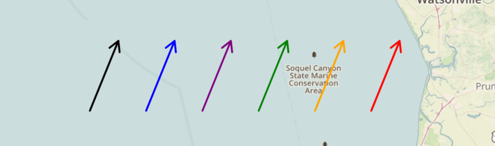

# leaflet-arrowheads

This is fork of [slutske22/leaflet-arrowheads](https://github.com/slutske22/leaflet-arrowheads) focussed on simplicity.

Instead of drawing decorations on a `Polyline` in creates a new class `Arrow` with simplified options and constant size across zoom levels.

<p align="center">
  
</p>

## Installation

Leaflet-Arrowheads is compatible with leaflet v2.

## Usage

Arrowheads can be applied to any polyline, whether unisegmental, multisegmental, continuous, or discontinuous:

```javascript
let myArrow = new Arrow([coords]);
```

Arrows can take a configuration object as its argument:

```javascript
let myArrow = new Arrow([ coords ], { <Options> });
```

## Options

Arrows offer a variety of options for rendering and styling arrowheads.
See the options table below.

Arrows inherit all options from Polyline.
Arrows also inherit all options from their parent polylines, except `fill`, `fillOpacity`, and `smoothFactor`.
These can be changed manually when defining the arrowheads' options, but changing smoothFactor will result in improperly rendered arrows.

<table>

   <tr>
      <td> <b> Option </b> </td>
      <td> <b> Type </b> </td>
      <td> <b> Default </b> </td>
      <td> <b> Description </b> </td>
   </tr>
   <tr></tr>

   <tr>
      <td> yawn </td>
      <td> Number <i color="grey"> ( Degrees ) </i> </td>
      <td> 60 </td>
      <td> Defines the width of the opening of the arrow head, given in degrees. The larger the angle, the wider the arrowhead. </td>
   </tr>
   <tr></tr>

   <tr>
      <td> headFill </td>
      <td> Boolean </td>
      <td> false </td>
      <td> Defines if the arrow head is filled with color or not. </td>
   </tr>
   <tr></tr>

</table><br>
<br>

## Examples

See file in example folder.

## Limitations

Arrowheads sometimes look like they're in slightly the wrong orientation in areas of high curvature. This is because of the way leaflet-arrowheads chooses and interpolates the points that it uses to calculate bearings. This may be able to be improved. Feel free to contribute / open a PR.
